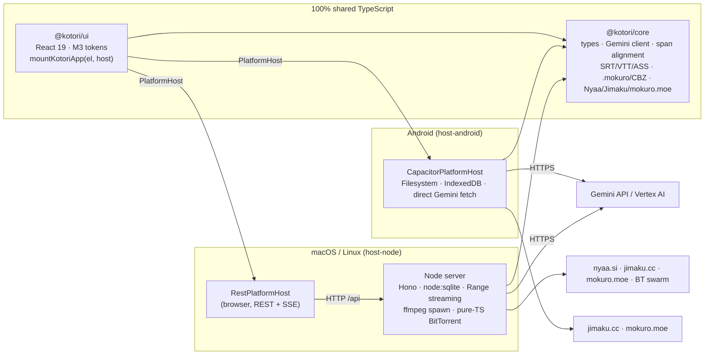
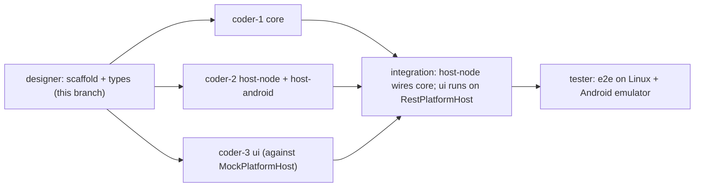

# Kotori — Technical Architecture & Module Boundaries (v1)

> Companion to [DESIGN.md](./DESIGN.md) (the PRD). This document is the build
> contract for the three parallel implementers:
> **coder-1 → `packages/core`**, **coder-2 → `packages/host-node` + `packages/host-android`**,
> **coder-3 → `packages/ui`**. Everything that crosses a package boundary is typed in
> [`packages/core/src/types.ts`](./packages/core/src/types.ts) — read it first; it is the law.

---

## 0. Ground rules (apply to every coder)

| Rule | Detail |
| :--- | :--- |
| **Toolchain** | Node `>=22.13` (built-in `node:sqlite`, `fetch`, `Intl.Segmenter`), pnpm 10, TypeScript 5.9 (`strict`, `exactOptionalPropertyTypes`, `noUncheckedIndexedAccess`, `verbatimModuleSyntax`), Vitest 4, Vite 7, React 19. Always `export PATH="$HOME/.local/share/fnm/node-versions/v22.22.1/installation/bin:$PATH"`. |
| **Zero native addons** | `pnpm-workspace.yaml` has `onlyBuiltDependencies: []` (pnpm 10 then refuses to run any dependency build script) and `overrides` that delete `better-sqlite3`, `sqlite3`, `node-datachannel`, `canvas`, `sharp`, `utp-native`, `bufferutil`, `utf-8-validate`. `pnpm run check:native` scans the production tree of `@kotori/host-node` + `@kotori/core` for `.node`/`binding.gyp`/`node-gyp-build`/`prebuild-install` and fails CI. **Do not add webtorrent** (→ `webrtc-polyfill` → `node-datachannel`). Dev-only prebuilt executables (esbuild/rollup platform packages) are acceptable; they are never shipped at runtime. |
| **Imports** | Extensionless relative imports (`'./foo'`), `moduleResolution: Bundler`. Workspace packages are consumed **as TypeScript source** (`main: ./src/index.ts`); no build step is needed for typecheck/tests. |
| **File ownership** | A file is owned by exactly one coder (tables below). Never edit another package. Need a type change? Post `@designer` on the board with the exact diff; additive optional fields are pre-approved. |
| **Errors** | Throw `KotoriError(code, message, { details })` from `@kotori/core`. Hosts serialise with `toShape()`, the REST client rebuilds with `fromShape()`. UI switches on `error.code`. |
| **Text indices** | UTF-16 code units everywhere (`string.length` semantics); `CharSpan` is half-open `[start, end)`. Grapheme logic (`Intl.Segmenter`) is only for *display* and for the “single grapheme” test in karaoke merging. |
| **Tests** | Co-located `*.test.ts(x)`; `pnpm test` runs all projects; fixtures under `packages/<pkg>/test-fixtures/`. Parsers must be tested against real-world samples (ASS karaoke, Shift_JIS SRT, `.mokuro` v0.2, Nyaa RSS, Jimaku JSON, mokuro.moe HTML). |
| **Verify before handoff** | `pnpm install && pnpm typecheck && pnpm test && pnpm check:native` green in your worktree. |

---

## 1. System overview



**One UI, one contract, two hosts.** `packages/ui` never knows which platform it runs on beyond `host.info.capabilities`. Desktop runs the UI in the user's browser (Chrome/Chromium `--app=` window when available, else default browser) against a local HTTP server. Android runs the same UI inside a Capacitor WebView with an in-process host.

### 1.1 Dependency graph (enforced)

```
core        → (nothing in the workspace)          runtime deps: fflate, zod
ui          → core                                 runtime deps: react, react-dom, zustand, @material/material-color-utilities
host-node   → core, ui (web entry only)            runtime deps: hono, @hono/node-server, bencode, bittorrent-protocol, bittorrent-dht, ut_metadata, google-auth-library
host-android→ core, ui                             runtime deps: @capacitor/*, idb, react, react-dom
```

`core` must stay **platform-neutral**: no `node:*`, no DOM-only API beyond `fetch`, `TextDecoder`, `crypto.subtle`, `Intl.Segmenter`, `AbortController`. Anything I/O-ish is injected (`fetch`, `now()`, cache store).

---

## 2. Repository layout & ownership

```
kotori/
├── package.json                 root scripts (typecheck, test, build, check:native)
├── pnpm-workspace.yaml          onlyBuiltDependencies: [] + native overrides
├── tsconfig.base.json
├── vitest.config.ts             projects: packages/*
├── scripts/check-native-deps.mjs
├── DESIGN.md · ARCHITECTURE.md
└── packages/
    ├── core/          @kotori/core          ← coder-1 (except src/types.ts: designer)
    ├── ui/            @kotori/ui            ← coder-3
    ├── host-node/     @kotori/host-node     ← coder-2
    └── host-android/  @kotori/host-android  ← coder-2
```

Each package has `package.json`, `tsconfig.json`, `vitest.config.ts`, `src/index.ts` already (scaffold). Sub-module `index.ts` files carry a header comment listing the planned files; those lists are **the authoritative task breakdown** and are repeated below with signatures.

---

## 3. The `PlatformHost` contract (core/src/types.ts §7)

```ts
interface PlatformHost {
  info: HostInfo;           // platform, os, capabilities, dataDir
  settings: SettingsApi;    // get / update(patch) / testAi
  anime: AnimeApi;          // library, episodes, cues, tracks, progress, autoFetchJimaku
  manga: MangaApi;          // volumes, pages(+blocks), readingMode, progress, addBlocks
  ai: AiApi;                // explain, getCachedExplanation, followUp(+Stream), ocrBubble, pageGuide, getThread, clearCache
  downloads: DownloadsApi;  // searchNyaa, searchJimaku, listJimakuFiles, browseMokuroCatalog, start/pause/resume/cancel/remove/selectFiles
  files: FilesApi;          // optional pickers / path browser / openExternal (see capabilities)
  subscribe(listener: (e: HostEvent) => void): Unsubscribe;
  dispose(): Promise<void>;
}
```

Semantics every implementation must honour:

1. **Capabilities over exceptions.** Whole features that a host cannot do are advertised `false` in `HostCapabilities`; the UI hides them. Only per-call failures throw.
2. **`mediaUrl` / `imageUrl` are host-resolved.** Desktop: `/media/{episodeId}` (HTTP 206 Range) and `/api/manga/{volumeId}/page/{index}/image`. Android: `Capacitor.convertFileSrc(absolutePath)`. The UI just assigns them to `<video src>` / ``.
3. **Explanation text identity.** `ExplainRequest.sentence` must be byte-identical to the string the UI indexes: `SubtitleCue.text` (or `mergeCuesToSentence()` output for multi-cue selection) and `MangaBlock.text` (`lines.join('')`). Hosts pass it through untouched.
4. **Caching is a host concern, keyed by `SentenceExplanation.id`** (`explanationCacheKey()` from core). `ai.getCachedExplanation` must resolve in < 5 ms for hits so a second click on the same sentence feels instant.
5. **Events.** `download-updated` at most every 500 ms per task (coalesce), plus on every status change; `library-changed` after any import/remove; `settings-changed` after `update`.
6. **Progress saves are fire-and-forget** for the UI (host debounces persistence).

### 3.1 Desktop wire format (`@kotori/host-node/shared`, owner coder-2)

* `API_PREFIX = '/api'`, JSON envelope `{ ok: true, data } | { ok: false, error: KotoriErrorShape }`, HTTP status mapped from `code` (`not-found`→404, `invalid-argument`→400, `unsupported`→501, `ai-auth`→401, `ai-quota`→429, else 500).
* Route table (`shared/routes.ts`) is a typed object `{ method, path }` keyed by `PlatformHost` method name (`'anime.getCues'` → `GET /api/anime/tracks/:trackId/cues`). The client builds requests from it; the server mounts handlers from it; a test asserts both sides cover every key.
* Events: `GET /api/events` Server-Sent Events, each event `data:` a `HostEvent` JSON; client reconnects with backoff.
* Streaming follow-up: `POST /api/ai/follow-up/stream` → `text/event-stream` of `FollowUpDelta`.
* Media: `GET /media/:episodeId` with `Range` → 206, `Accept-Ranges: bytes`, correct `Content-Type` (`video/mp4`, `video/x-matroska`, `video/webm`).
* Binary uploads (subtitle import from browser file picker): `POST /api/anime/episodes/:id/tracks` multipart; otherwise paths come from the server-side path browser (`files.listDirectory`).

---

## 4. `@kotori/core` — coder-1

### 4.0 Package rules
* No workspace deps. Runtime deps: `fflate` (zip), `zod` (model output validation). Nothing else without asking.
* Every public function pure or taking injected `deps` (`fetch`, `now`). Export from the sub-module `index.ts` *and* keep the root `src/index.ts` barrel compiling.
* `src/types.ts` is read-only for coder-1.

### 4.1 `src/ai/` — Gemini Flash breakdown engine

| File | Exports | Notes |
| :--- | :--- | :--- |
| `gemini-client.ts` | `createGeminiClient(settings: AiSettings, deps: { fetch?: typeof fetch; accessTokenProvider?: () => Promise<string> }): GeminiClient` with `generate(req, signal?): Promise<GeminiResponse>` and `generateStream(req, onText, signal?)` | **REST only, no SDK.** `gemini-api`: `POST {baseUrl}/{apiVersion}/models/{model}:generateContent` with header `x-goog-api-key`. `vertex-ai`: `POST https://{location}-aiplatform.googleapis.com/v1/projects/{project}/locations/{location}/publishers/google/models/{model}:generateContent` with `Authorization: Bearer` (token from `auth.accessToken`, from `createServiceAccountTokenProvider` for `service-account-json`, or from `deps.accessTokenProvider` for `adc`); `location === 'global'` → `https://aiplatform.googleapis.com`; `express-api-key` → `?key=` on the Vertex endpoint, no project. Supports `responseMimeType: application/json` + `responseSchema`, `thinkingConfig.thinkingBudget`, `temperature`, inline image parts, `AbortSignal` (caller's signal + timeout → `cancelled` / `ai-timeout`). Maps HTTP 401/403→`ai-auth`, 429→`ai-quota`, safety blocks→`ai-safety`, bad JSON→`ai-invalid-response`. |
| `service-account.ts` | `createServiceAccountTokenProvider(json: string, deps: { fetch?: typeof fetch; now?: () => number }): () => Promise<string>`, `parseServiceAccountJson(json)` | Platform-neutral SA auth (works on Android too): parse `client_email`/`private_key`/`token_uri`; import PKCS#8 PEM with `crypto.subtle.importKey('pkcs8', …, RSASSA-PKCS1-v1_5/SHA-256)`; sign JWT `{iss, scope: 'https://www.googleapis.com/auth/cloud-platform', aud: token_uri, iat, exp: iat+3600}`; `POST token_uri` with `grant_type=urn:ietf:params:oauth:grant-type:jwt-bearer`; cache the token and refresh 60 s before `expires_in`. Errors → `ai-auth`. |
| `credentials.ts` | `resolveAccessTokenProvider(auth: VertexAuth, deps: { adc?: () => Promise<string>; fetch?; now? }): (() => Promise<string>) | undefined` | Single switch used by both hosts: `access-token` → static (warn when `expiresAt` passed), `service-account-json` → `createServiceAccountTokenProvider`, `adc` → `deps.adc` (host-injected; `unsupported` when missing), `express-api-key` → `undefined` (key goes in the query string). |
| `explain-schema.ts` | `RawExplanationSchema` (zod) + `EXPLAIN_RESPONSE_SCHEMA` (Gemini JSON schema) | The model returns `surface` strings and readings, **never indices**. Shape: `{ translation, literalTranslation?, register?, tone?, ruby: [{base, ruby?}], chunks: [{surface, reading, textbookForm, spokenEvolution?: {kind, derivation, formality?}, role, meaning, nuance?, vocab: [{surface, lemma, lemmaReading, lemmaRuby:[{base,ruby?}], partOfSpeech, meaning, conjugation?, jlpt?, pitchAccent?, notes?}]}], grammar: [{pattern, chunkSurfaces: string[], explanation, jlpt?}] }`. |
| `prompts.ts` | `PROMPT_VERSION = 'v1'`, `buildExplainPrompt(req)`, `buildFollowUpPrompt(expl, history, question)`, `buildBubbleOcrPrompt(req)`, `buildPageGuidePrompt(req)` | System prompt demands: chunks cover the sentence left-to-right in order; `surface` must be a verbatim substring; furigana only on kanji; `textbookForm` always present; `spokenEvolution` only when surface ≠ textbook; output language = `targetLanguage`; context lines are *context only*. |
| `span-align.ts` | `alignSpans(sentence: string, surfaces: readonly string[]): { spans: CharSpan[]; alignment: SpanAlignment[] }` | **Deterministic.** Monotonic cursor; pass 1 `indexOf(surface, cursor)` → `exact`; pass 2 compare on normalised forms (NFKC, strip spaces/`　`, `～`↔`〜`, long-vowel marks, katakana→hiragana) mapping back to original offsets → `fuzzy`; else `[cursor, cursor)` → `unaligned`. Spans never overlap; a later exact match may not start before the previous span end. Also `clampSpans()` and `spansCover(sentence, spans)` for metrics. |
| `ruby.ts` | `buildRuby(sentence, raw: {base, ruby?}[]): RubySegment[]` | Walks the sentence; when `raw` bases do not concatenate to `sentence`, falls back to per-run segmentation (kanji runs get `ruby` if a reading can be attributed, else no ruby) so `ruby.map(r=>r.base).join('') === sentence` **always** holds. |
| `explanation.ts` | `toSentenceExplanation(raw, req, meta: { model; usage?; now })`, `findChunkAt(expl, charIndex): SemanticChunk | undefined`, `findVocabAt(expl, charIndex)`, `chunkIndexAt()` | Builds ids (`c0..`, `v0..`, `g0..`), runs `alignSpans` for chunks and (within each chunk) for vocab, fills `vocabIds`, resolves `grammar.chunkSurfaces` → `chunkIds`. `findChunkAt` is O(log n) over sorted spans and treats a click on whitespace/punctuation between chunks as “nearest chunk to the right, else left”. |
| `cache-key.ts` | `explanationCacheKey({ sentence, targetLanguage, model, promptVersion }): Promise<string>` | `sha256` via `crypto.subtle`, hex, prefix `ex_`. Pure sync fallback `fnv1a64` for environments without subtle (tests). |
| `explain-service.ts` | `createExplainService(deps: { client; cache: ExplanationCache; settings: () => AiSettings; now? }): ExplainService` where `ExplanationCache = { get(id), put(expl), getThread(id), appendThread(id, msg), clear() }` | Implements `AiApi` minus host plumbing (same signatures incl. `AiCallOptions.signal`): cache lookup → prompt → client → validate → align → cache put. Follow-up: uses `request.explanation` when supplied, else cache by `explanationId` (`not-found` if neither); thread context + explanation JSON summary. Retries once on `ai-invalid-response` with a “return valid JSON” nudge. Aborted calls reject with `cancelled` and never write the cache. |
| `vision.ts` | `ocrBubble(client, req): Promise<MangaBubbleOcrResult>`, `pageGuide(client, req): Promise<MangaPageGuideResult>` | Image part + JSON schema; `rectFraction` clamped to 0..1; when `req.explain` is true, runs the text through the explain pipeline in the same service call. |

### 4.2 `src/subtitle/` — SRT / VTT / ASS engine

| File | Exports | Notes |
| :--- | :--- | :--- |
| `detect.ts` | `decodeSubtitleBytes(bytes: Uint8Array): { text; encoding }`, `detectSubtitleFormat(text, fileName?)` | BOM sniff; UTF-8 validity check; fallback `TextDecoder('shift_jis')` then `euc-jp`; format by header (`[Script Info]`, `WEBVTT`, numeric SRT block). |
| `srt.ts` / `vtt.ts` | `parseSrt(text)`, `parseVtt(text)` → `ParsedSubtitleTrack` | Strip `<i>`, `<font>`, `<ruby>…<rt>…</rt></ruby>` (keep base), `{\an8}` in SRT; VTT cue settings ignored; tolerate CRLF, missing index, overlapping cues. |
| `ass.ts` | `parseAss(text)`, `stripAssTags(raw): string`, `parseAssMarkup(event, scriptInfo): AssMarkup` | Parses `[Script Info]` (`PlayResX/Y`, default 384×288), `[V4+ Styles]` names, `[Events]` `Format:` column order. `Dialogue`/`Comment` both become cues (`isComment`). Override tags: `\pos`→`posFraction`, `\an`/`\a` legacy, `\move`, `\fad`/`\fade`, `\k*`, `\p1`, `\N`→`\n`, `\h`→space, drop everything else. `text` has **no tags**; `{\rt…}`/ruby via `\N`-less furigana conventions are folded to base. |
| `parse.ts` | `parseSubtitle(input: { bytes?: Uint8Array; text?: string; fileName?: string }): ParsedSubtitleTrack` | Dispatch. |
| `merge-per-char.ts` | `mergePerCharacterCueGroups(cues: readonly SubtitleCue[]): MergedCueGroups` | **Port of Fushi `mergePerCharacterCueGroups` exactly** ([reference](/usr/local/google/home/chii/Developer/Fushi/fushi/lib/src/media/video/video_subtitle_jump_panel.dart#L26-L131)). Criteria for a group: every member has `markup.posFraction`; `text` is a single grapheme (`Intl.Segmenter`); same `markup.layer`; `|yFraction − head.yFraction| ≤ 0.001`; time **intersects the group's common on-screen window** (`liveStart/liveEnd` shrink; **not** the union — union chaining was BUG-1439); ≥ 2 members. Group text = members sorted by `xFraction` ascending, joined; `startMs = min`, `endMs = max`; `markup` dropped (`undefined`); `index` = head's. Returns `byRep` and `repByRaw` (every member → head). Non-members are skipped (`i++`). |
| `transcript.ts` | `buildTranscriptRows(cues, opts: { mergeKaraoke: boolean; hideSigns: boolean; chainFoldGapMs?: 40 }): TranscriptRow[]` | Port of `subtitleTranscriptRows`: (1) karaoke merge, (2) exact `(startMs, text)` de-dup, (3) adjacency-chain fold for same-text cues whose `startMs ≤ chainEnd + 40 ms`, (4) `hideSigns` drops `isDrawing`, `hasMove`, `isComment`, empty text. |
| `cue-utils.ts` | `cueIndexAt(cues, ms)`, `activeCueIndexes(cues, ms)`, `nextCueIndex`, `prevCueIndex`, `applyDelay(cues, delayMs)`, `mergeCuesToSentence(cues: SubtitleCue[]): { text; startMs; endMs; cueIndexes; cueCharSpans: CharSpan[] }`, `cueOffsetToSentenceIndex(source: ExplainSource & { kind: 'subtitle' }, cueIndex: number, localCharIndex: number): number`, `sentenceIndexToCueOffset(source, sentenceIndex): { cueIndex; localCharIndex } | undefined` | `mergeCuesToSentence` joins with no separator when the previous text ends without terminal punctuation and the next starts with a continuation, otherwise with `\n`; `cueCharSpans[k]` is the span of cue `k`'s text inside `text` (separators are owned by no cue). This exact `text` is what gets explained; a single cue yields `cueCharSpans: [[0, text.length]]`. The two offset helpers are the only sanctioned way to translate overlay/transcript clicks ⇄ sentence indices. |
| `episode-name.ts` | `parseEpisodeName(fileName): ParsedEpisodeName` | Handle `[Group] Title - 01 (1080p) [CRC].mkv`, `Title S01E02`, `第01話`, `01v2`, batches `01-12`/`01~12`, `[BD 1080p HEVC FLAC]`, strip extension; never throws. |
| `language.ts` | `detectSubtitleLanguageFromName(fileName): LanguageTag | undefined` | `.ja.`, `.jpn.`, `[JP]`, `日本語`, `.zh-Hans.` … |

### 4.3 `src/manga/` — `.mokuro` / CBZ / layout

| File | Exports | Notes |
| :--- | :--- | :--- |
| `mokuro.ts` | `parseMokuro(json: string): ParseResult<MokuroDocument>`, `parseMangaJson(json)`, `serialiseMangaJson(doc)`, `normaliseMangaUrl(raw)`, `resolveMokuroPageRoot(doc, volumeName, exists: (rel) => boolean): string[] | undefined`, `mokuroPageRootCandidates(volumeName)` | `MokuroDocument = { title?, titleUuid?, volume?, volumeUuid?, pages: Array<Omit<MangaPage,'imageUrl'>> }`. mokuro v0.2 keys: `pages[].img_path`, `img_width`, `img_height`, `blocks[].box [x1,y1,x2,y2]`, `vertical`, `font_size`, `lines`, `lines_coords`. Tolerant (defaults, skips malformed). `text = lines.join('')`. Page root resolution mirrors [Fushi `resolveMokuroPageRoot`](/usr/local/google/home/chii/Developer/Fushi/packages/fushi_engine/lib/media/manga/mokuro_payload.dart#L194-L247): candidates `[]` (images beside the `.mokuro`) then `[volumeName]` (images in a same-named subfolder). |
| `cbz.ts` | `listArchiveImages(bytes: Uint8Array): ArchiveImageEntry[]` (natural-sorted, image extensions only, skips `__MACOSX`), `readArchiveEntry(bytes, entry): Uint8Array`, `readImageSize(bytes): { width; height } | undefined` (JPEG/PNG/WebP/GIF header sniff) | `fflate.unzipSync` with a filter; streaming not required (volumes ≤ ~300 MB). |
| `regions.ts` | `deriveCharRegions(block: MangaBlock): MangaCharRegion[]` | If `regions` present return them; else subdivide each `linesCoords` quad (or the block rect split evenly per line) into per-grapheme cells along the writing direction, mapping UTF-16 offsets. |
| `hit-test.ts` | `blockAt(page, x, y): MangaBlock | undefined` (highest `zIndex`, smallest area wins), `charIndexAt(block, x, y): number` (nearest region centre) | Page-pixel inputs. |
| `layout.ts` | `buildSpreads(pages: readonly { index; width; height }[], opts: { mode: MangaReadingMode; coverIsSingle: boolean }): MangaSpread[]`, `spreadIndexForPage(spreads, pageIndex)` | Single modes → one slot per page. Spread modes: cover alone when `coverIsSingle`; wide pages (`width > height`) alone; RTL fills `right` first. Webtoon → single column (same as single-ltr for the model). |
| `volume-name.ts` | `parseVolumeName(name): { seriesTitle; volumeNumber? }` | `第3巻`, `v03`, `Vol. 3`, `03`. |

### 4.4 `src/acquire/` — discovery parsers & clients

| File | Exports | Notes |
| :--- | :--- | :--- |
| `nyaa.ts` | `buildNyaaRssUrl(q: NyaaSearchQuery, base = 'https://nyaa.si')`, `parseNyaaRss(xml): NyaaTorrentItem[]`, `parseNyaaSize(text)`, `buildNyaaMagnet(infoHash, title)` | RSS `?page=rss&q=&c=1_4&f=0&s=seeders&o=desc`. Item fields: `title`, `link` (torrent), `guid` (page), `nyaa:infoHash`, `nyaa:seeders`, `nyaa:leechers`, `nyaa:downloads`, `nyaa:size`, `nyaa:categoryId`, `nyaa:trusted`, `nyaa:remake`, `pubDate`. Hand-rolled tolerant XML item scanner (no DOMParser dependency). Magnet trackers: nyaa's default list (`http://nyaa.tracker.wf:7777/announce`, `udp://open.stealth.si:80/announce`, `udp://tracker.opentrackr.org:1337/announce`, `udp://exodus.desync.com:6969/announce`, `udp://tracker.torrent.eu.org:451/announce`). |
| `jimaku.ts` | `createJimakuClient({ fetch, apiKey, baseUrl = 'https://jimaku.cc' })` with `searchEntries(q: JimakuSearchQuery): JimakuEntry[]` (`GET /api/entries/search?query=&anilist_id=`), `listFiles(entryId, episode?)` (`GET /api/entries/{id}/files?episode=`); `mapJimakuEntry(raw)`, `mapJimakuFile(raw)`, `matchJimakuFilesToEpisodes(files, episodes): Map<episodeId, JimakuFile>` | Header `Authorization: {apiKey}`. 429 → `ai-quota`-like `network` error with `details.retryAfterMs`. Matching: episode number from `JimakuFile.episode` vs `AnimeEpisode.parsedName.episode`; prefer `.ass` > `.srt` > `.vtt`, newest `lastModifiedAt`. |
| `mokuro-moe.ts` | `parseMokuroMoeListing(html: string, url: string): MokuroCatalogListing` | Parses the nginx/caddy autoindex table (`<a href>`, size, date columns); pairs `X.mokuro` with `X.zip`/`X.cbz`/`X/`; directory URLs keep trailing `/`. |
| `magnet.ts` | `parseMagnet(uri): { infoHash; name?; trackers: string[] }`, `buildMagnet(parts)` | Hex and base32 `btih`. |

### 4.5 `src/util/`
`errors.ts` (done), `hash.ts` (`sha256Hex`, `fnv1a64`), `graphemes.ts` (`splitGraphemes`, `graphemeCount`), `text.ts` (`normaliseJapanese`, `isKanji`, `isKana`, `katakanaToHiragana`), `time.ts` (`formatClock`), `natural-sort.ts` (`compareNatural`).

### 4.6 Definition of done (core)
* All exports above implemented with JSDoc; ≥ 1 test per public function; fixtures for: ASS karaoke per-char events (reproduce the Fushi example `{\an7\pos(461,672)\fad(250,250)}手` …), Shift_JIS SRT, VTT with ruby, `.mokuro` v0.2 both page-root conventions, CBZ with nested dirs, Nyaa RSS sample, Jimaku JSON sample, mokuro.moe HTML sample, Gemini raw JSON sample (one standard + one slangy sentence `食べてんじゃねぇよ` → chunk `てんじゃねぇ` with `textbookForm: 'ているのではない'`).
* `alignSpans` property test: for random sentences and random substring splits, every span is `exact` and spans are disjoint & ordered.

---

## 5. `@kotori/host-node` — coder-2 (desktop: macOS / Linux)

### 5.0 Runtime model
* `pnpm --filter @kotori/host-node build` → `vite build web` (UI → `dist/web`) + `node build.mjs` (esbuild bundles `src/server/main.ts` **and `@kotori/core`** into `dist/server.mjs`). End users run `node bin/kotori.mjs` (or `npx kotori`): plain Node, no TS toolchain, no addons.
* Dev: `pnpm dev:node` = `tsx watch src/server/main.ts --dev` + `vite dev web` (proxy `/api`, `/media` → `127.0.0.1:7865`).
* Data dir default `~/.kotori/` (`--data-dir`): `kotori.sqlite`, `subtitles/`, `downloads/`, `manga/` (imported archives extracted here), `cache/`.
* On start: open `http://127.0.0.1:{port}` — try Chrome/Chromium/Edge `--app=URL --user-data-dir={dataDir}/chrome-profile` (standalone window feel), fall back to `open`/`xdg-open`. `--no-open` disables.
* Binds `127.0.0.1` only (no auth; local tool).
* `node:sqlite` still emits `ExperimentalWarning: SQLite is an experimental feature` on Node 22. `bin/kotori.mjs` installs a `process.on('warning')` filter that swallows only that warning (done in scaffold); keep it, do not blanket-disable warnings in library code.

### 5.1 Layout

```
packages/host-node/
├── bin/kotori.mjs              runtime launcher (done)
├── build.mjs                   esbuild bundler (done)
├── web/                        browser entry: index.html, main.tsx (mounts @kotori/ui with RestPlatformHost), vite.config.ts
└── src/
    ├── shared/                 browser-safe: routes.ts (typed route table), wire.ts (envelope + error (de)serialisation), index.ts
    ├── client/                 browser-safe: rest-host.ts (createRestPlatformHost), http.ts, events.ts (SSE), index.ts
    ├── server/
    │   ├── main.ts             CLI → createServer() → listen → open browser
    │   ├── app.ts              createApp(ctx): Hono — routes + static dist/web + SPA fallback
    │   ├── context.ts          ServerContext { options, db, settings, explainService, downloads, library, ffmpeg }
    │   └── routes/             settings.ts anime.ts manga.ts ai.ts downloads.ts files.ts media.ts events.ts
    ├── db/
    │   ├── sqlite.ts           openDatabase(path): DatabaseSync (node:sqlite), WAL, migrate()
    │   ├── migrations/001_init.sql …
    │   └── repositories/       series.ts episodes.ts tracks.ts volumes.ts pages.ts explanations.ts threads.ts downloads.ts
    ├── library/
    │   ├── anime-scanner.ts    scanAnimeFolder(dir) → series/episodes + sidecar subtitle discovery (*.srt/.ass/.vtt, language suffixes)
    │   ├── manga-importer.ts   importMokuro(path) / importArchive(path) / importImageDir(path) → MangaVolume (+ page rows)
    │   └── subtitle-store.ts   writes downloaded/extracted subtitle files under dataDir/subtitles/{episodeId}/
    ├── media/
    │   ├── range-stream.ts     serveRange(c, filePath, mime) — 206 / 416 / HEAD
    │   └── ffmpeg.ts           findFfmpeg(), probeStreams(file) (ffprobe JSON), extractSubtitleStream(file, streamIndex, outPath)
    ├── ai/credentials.ts       ADC only: `adcTokenProvider()` via google-auth-library `GoogleAuth({ scopes: cloud-platform })`, passed as `deps.adc` to core's `resolveAccessTokenProvider` (SA-JSON / access-token / express key are handled in core)
    ├── torrent/                pure-TS BitTorrent client (see 5.4)
    ├── downloads/manager.ts    DownloadManager: queue (maxActive), per-kind workers, progress → HostEvent, auto-import
    ├── settings/store.ts       defaults.ts + JSON column in sqlite, migration, redaction for logs
    └── types/vendor.d.ts       ambient typings for bencode / bittorrent-protocol / bittorrent-dht / ut_metadata (refine as needed)
```

### 5.2 Database (node:sqlite)
Single file, WAL mode, `PRAGMA foreign_keys=ON`. Tables: `settings(key, json)`, `anime_series`, `anime_episodes`, `subtitle_tracks`, `playback_progress`, `manga_volumes`, `manga_pages(volume_id, page_index, relative_path, width, height, blocks_json)`, `manga_progress`, `explanations(id PK, sentence, target_language, model, prompt_version, json, created_at)`, `follow_up_threads(explanation_id, seq, role, text, created_at)`, `download_tasks(id, kind, status, json, updated_at)`, `schema_migrations`. Repositories return the `types.ts` shapes directly (`mediaUrl`/`imageUrl` filled by the route layer).

### 5.3 Media & subtitles
* `GET /media/:episodeId`: resolve `filePath`, `fs.stat`, honour `Range: bytes=a-b`, stream with `fs.createReadStream`; MIME by extension. MKV plays in Chromium when the codecs are H.264/VP9/AV1 + AAC/Opus/Vorbis/FLAC; HEVC/AC-3 will not — surface a `host-notice` warning from `probeStreams` when ffprobe is available.
* Embedded subtitles: `ffprobe -show_streams -print_format json`; `codec_type=subtitle` with `codec_name ∈ {ass, ssa, subrip, webvtt, mov_text}` listed as `SubtitleTrack{origin:'embedded', streamIndex}`; extraction `ffmpeg -y -i file -map 0:{i} out.ass` (ssa→ass, mov_text→srt). Absent ffmpeg → `capabilities.embeddedSubtitles=false`.
* Sidecar matching: same basename prefix; language from `detectSubtitleLanguageFromName`; prefer `ja`.
* `anime.getCues` parses via `@kotori/core` once and caches the `ParsedSubtitleTrack` in memory (LRU 32) keyed by `(trackId, mtime)`, applying `delayMs`.

### 5.4 Pure-TS BitTorrent engine (`src/torrent/`)
No webtorrent. Composition of pure-JS building blocks + our own glue:

| File | Responsibility |
| :--- | :--- |
| `metainfo.ts` | `parseTorrentFile(bytes)` (bencode → info hash via `node:crypto` sha1, files, piece length, pieces), `parseMagnet` (re-export core), `infoDictFromMetadata(bytes)` |
| `tracker-http.ts` / `tracker-udp.ts` | Announce (`started/stopped/completed`, compact peers), BEP 15 UDP via `node:dgram` with connection-id cache & retries; scrape not needed |
| `dht.ts` | `bittorrent-dht` wrapper: `lookup(infoHash)` peer stream, `announce` |
| `peer.ts` | One `bittorrent-protocol` `Wire` over `node:net` socket; handshake, extension handshake, `ut_metadata` (BEP 9) for magnets, request pipelining (≤ 16 outstanding, 16 KiB blocks), choke/interest state, timeouts |
| `piece-picker.ts` | Rarest-first with **sequential bias for the first/current video file** (so playback can start while downloading), end-game duplication |
| `storage.ts` | Multi-file piece ↔ file offset mapping, `fs.promises` `FileHandle` writes with `fsync` on piece verify, sha1 verification, resume via bitfield file `{infoHash}.bitfield` |
| `torrent.ts` | `Torrent` class: state machine `resolving → downloading → seeding/completed`, peer pool (≤ `maxPeersPerTorrent`), rate limiting, stats (`speedBps`, `peers`, `etaMs`), `selectFiles()` |
| `client.ts` | `TorrentClient`: shared peer-id (`-KT0100-`), listening port (TCP incoming), DHT singleton, `add(magnet|torrentUrl|bytes)`, `remove`, persistence hooks |

Tests: unit (bencode round-trip, piece mapping, picker), integration with an in-process seeder (two `TorrentClient`s over loopback exchanging a generated 2 MiB payload) — must pass in CI without network.

### 5.5 Downloads manager
`start(request)` → task row + worker by `source.kind`: `torrent` → `TorrentClient`; `jimaku` → `fetch` stream to `subtitles/`, unzip `.zip` packs with fflate, pick episode files by `parseEpisodeName`; `mokuro-moe` → download `.mokuro` + images archive to `manga/{name}/`; `http` → generic. On completion with `autoImport`: anime → `rescanSeries`/`importSeries`; subtitle → `addSubtitleTrack`; manga → `importVolume`. Emit `download-updated` (coalesced 500 ms) and `library-changed`.

### 5.6 `RestPlatformHost` (browser)
`createRestPlatformHost({ baseUrl? })`: every `PlatformHost` method = `fetchJson(route, params, body)`; `subscribe` multiplexes one `EventSource`; `files.pickDirectory/pickFiles` are `undefined` (desktop uses `listDirectory` path browser instead); `capabilities` come from `GET /api/info`. Unit tests with a mocked `fetch` assert URL/method/body per route.

---

## 6. `@kotori/ui` — coder-3

### 6.0 Package rules
* Entry: `mountKotoriApp(container, host)` (done). Everything reads the host through `useHost()`; **no direct `fetch`, no Capacitor, no Node**.
* M3 implementation: **own lightweight components** in `components/m3/` styled with CSS custom properties (`--md-sys-color-*`, `--md-sys-typescale-*`, shape tokens) generated by `theme/m3-theme.ts` from `UiSettings.seedColor` via `@material/material-color-utilities` (`themeFromSourceColor`, dark/light schemes). No MUI, no web-components dependency (keeps the bundle and the WebView fast).
* State: zustand stores per feature (`useAnimeStore`, `useMangaStore`, `useDownloadsStore`, `useSettingsStore`, `useBreakdownStore`); server data cached in stores and invalidated by `HostEvent`s.
* Dev harness `pnpm dev:ui` with `createMockPlatformHost()` (`src/host/mock-host.ts`) — realistic fixtures: 2 series × 3 episodes with ASS karaoke, 1 `.mokuro` volume (10 pages), 1 raw-image volume, canned `SentenceExplanation`s with chunks/vocab/spokenEvolution, simulated download progress. Tests use it too.

### 6.1 Layout

```
packages/ui/src/
├── index.ts                     mountKotoriApp (done)
├── app/                         App.tsx (done, extend) · Shell.tsx (NavRail ≥ 840px / NavBar < 840px) · routes.ts (zustand: tab + params) · Snackbar host
├── theme/                       m3-theme.ts · useTheme.ts · styles.css · typography.css
├── host/                        HostContext.tsx (done) · mock-host.ts · useHostEvents.ts · useAsync.ts
├── components/m3/               Button IconButton FilledCard OutlinedCard Chip AssistChip Dialog BottomSheet SideSheet Slider Switch TextField SegmentedButton Tabs LinearProgress CircularProgress ListItem Menu Tooltip
├── components/breakdown/
│   ├── AiBreakdownPanel.tsx     container: sentence (RubyText) + chunk cards + vocab + grammar + FollowUpThread; props { explanation, focusCharIndex, onFocusChange, onFollowUp }
│   ├── RubyText.tsx             renders RubySegment[] as <ruby>base<rt>ruby</rt></ruby>; data-char-start/end attrs; click → charIndex (caretRangeFromPoint/elementsFromPoint → nearest segment + offset)
│   ├── ChunkCard.tsx            📘 textbookForm · 🔥 spokenEvolution · role · meaning · nuance; highlighted state; scrollIntoView({block:'nearest', behavior:'smooth'}) when focused
│   ├── VocabList.tsx · GrammarList.tsx
│   ├── FollowUpThread.tsx       messages + input; uses ai.followUpStream when capabilities.streaming
│   └── useBreakdownSelection.ts  charIndex ⇄ chunkId two-way sync (findChunkAt), 0-latency (pure state, no host call)
├── features/anime/
│   ├── AnimeLibrary.tsx · SeriesDetail.tsx · ImportSeriesDialog.tsx (path browser or picker by capability)
│   ├── player/Player.tsx         <video> + overlay + right/bottom drawer; keyboard: ←/→ prev/next cue, R repeat, Space, Esc
│   ├── player/SubtitleOverlay.tsx  active cues (text only; per-char karaoke events render as their merged sentence when mergeKaraokeCues)
│   ├── player/TranscriptPanel.tsx  TranscriptRow list (virtualised), auto-follow, click → seek(startMs − seekPaddingMs), multi-select (shift/long-press) → mergeCuesToSentence → explain
│   ├── player/RepeatControls.tsx   single-sentence loop (repeatCount), A-B over selected rows
│   ├── player/SubtitleTrackMenu.tsx tracks, delay ±, extract embedded, add file, auto-fetch Jimaku
│   └── player/usePlayerSync.ts   timeupdate → active cue (cueIndexAt), rAF-free (uses requestVideoFrameCallback when available)
├── features/manga/
│   ├── MangaLibrary.tsx · ImportVolumeDialog.tsx
│   ├── reader/Reader.tsx         mode switch (single/spread/webtoon), RTL navigation, preloadPages
│   ├── reader/PageCanvas.tsx      + BlockOverlay scaled by page.width/height; pinch-zoom & pan (pointer events)
│   ├── reader/BlockOverlay.tsx   mokuro blocks as hit areas; tap → charIndexAt → explain(block.text, focusCharIndex)
│   ├── reader/SpreadLayout.tsx · Webtoon.tsx (virtualised column)
│   ├── reader/BubbleSelectTool.tsx  drag-rect on raw pages → canvas crop (JPEG q0.9, ≤ 1024px) → ai.ocrBubble({explain:true}) → BreakdownPanel; "save blocks" → manga.addBlocks
│   └── reader/PageGuideSheet.tsx   downscale page ≤ 1536px → ai.pageGuide → numbered bubble markers + list
├── features/downloads/
│   ├── DownloadsPage.tsx (tabs: Tasks · Anime(Nyaa) · Subtitles(Jimaku) · Manga(mokuro.moe))
│   ├── NyaaSearch.tsx · JimakuSearch.tsx · MokuroCatalogBrowser.tsx · DownloadList.tsx (live via HostEvent)
│   └── when !capabilities.torrent: "Open magnet in external app" via files.openExternal
└── features/settings/
    ├── SettingsPage.tsx
    ├── AiProviderForm.tsx       segmented: Gemini API Key | Vertex AI; Vertex sub-form: project, location, auth kind (access-token / service-account JSON / express key on every host; ADC shown only when capabilities.vertexAdc); model pickers; test button → settings.testAi
    ├── AppearanceSection.tsx · AnimeSection.tsx · MangaSection.tsx · DownloadsSection.tsx · LibrarySection.tsx
```

### 6.2 The click → highlight contract (core UX)
1. User clicks character at UTF-16 `localCharIndex` of cue `k` in `SubtitleOverlay` / `TranscriptPanel` (→ `focusCharIndex = cueOffsetToSentenceIndex(source, k, localCharIndex)`), or at `charIndex` of a block in `BlockOverlay`.
2. `useBreakdownStore.open({ sentence, source, focusCharIndex })`: if `ai.getCachedExplanation` hits (or the sentence equals the currently open explanation) → **no network**; else show skeleton and call `ai.explain(req, { signal })`, aborting any previous in-flight call (ignore its `cancelled` rejection).
3. `useBreakdownSelection` maps `focusCharIndex` → `findChunkAt(expl, i)` → highlighted `ChunkCard` + highlighted span inside `RubyText`; `ChunkCard` scrolls into view.
4. Clicking another character of the **same sentence** only updates `focusCharIndex` (pure state ⇒ 0 latency). Clicking a `ChunkCard` sets focus to `chunk.charSpan[0]` (reverse highlight).
5. Follow-up thread lives under the explanation; `getThread` restores it when reopening a cached explanation.

### 6.3 Definition of done (ui)
* All four tabs navigable on 360×800 (phone) and 1440×900 (desktop) layouts; dark/light themes from seed colour.
* Component tests (Testing Library + jsdom): RubyText click→charIndex mapping, useBreakdownSelection two-way sync, TranscriptPanel merge/dedupe display, AiProviderForm validation for both providers, Reader RTL spread navigation, BubbleSelectTool crop maths (pure helper), DownloadList event updates. Run against `MockPlatformHost`.
* No `any`, no `@ts-ignore`; bundle (desktop web) < 600 kB gzipped excluding fonts.

---

## 7. `@kotori/host-android` — coder-2 (Android standalone)

* Capacitor 8 app, `appId dev.kotori.app`, `webDir www` built by `web/vite.config.ts` from `web/main.tsx` (mounts `@kotori/ui` with `createCapacitorPlatformHost()`). `android/` is generated once with `pnpm --filter @kotori/host-android cap:add` and **committed** (Gradle caches/build dirs are gitignored at the root).
* `CapacitorPlatformHost` runs **entirely in the WebView** — no Node. Capabilities: `torrent:false`, `embeddedSubtitles:false`, `vertexAdc:false`, `directoryPicker:true`, `filePicker:true`, `pathBrowser:false`, `streaming:true`, `openExternal:true`.
* Storage: `idb` (IndexedDB) stores mirroring §5.2 tables (`settings`, `series`, `episodes`, `tracks`, `volumes`, `pages`, `explanations`, `threads`, `downloads`); app files under `Directory.Data` (`subtitles/`, `manga/`, `downloads/`). Library sources are SAF tree URIs picked with the Filesystem plugin's directory picker (Capacitor 8 `Filesystem.pickDirectory` / fallback community plugin — coder-2 decides and documents); episode `mediaUrl` = `Capacitor.convertFileSrc(uri)`.
* Manga archives are extracted with `fflate` (core `cbz.ts`) into `manga/{volumeId}/` once at import; `imageUrl` = converted file src. `.mokuro` pages whose images live next to the file are referenced in place.
* AI: `@kotori/core` explain service with plain `fetch` (Gemini API key, or Vertex `access-token` / `service-account-json` [token exchange in core via `crypto.subtle`] / `express-api-key`; only `adc` is unavailable). If CORS blocks a provider in the WebView, route via `CapacitorHttp` (set `plugins.CapacitorHttp.enabled=true` in `capacitor.config.ts`) — keep the same `fetch`-shaped function injected into core.
* Downloads: Jimaku / mokuro.moe / http via `fetch` + `Filesystem.writeFile` (chunked, base64-free `blob` path when available); torrents → `files.openExternal(magnet)` (intent to an installed BT app). Progress → `HostEvent`s.
* Tests (node env): host method mapping over an in-memory `idb` fake (`fake-indexeddb` may be added as a devDependency), settings defaults, import of a fixture `.mokuro`.

---

## 8. Cross-cutting decisions

| Topic | Decision |
| :--- | :--- |
| Gemini access | REST `generateContent` through core; **no `@google/genai` SDK** (keeps bundle small, identical code on both hosts, explicit dual-auth). Default models `gemini-2.5-flash` for both text and vision; user-editable. |
| Explanation determinism | `temperature 0.2`, JSON schema response, server-side `alignSpans` — the model never emits indices. |
| Karaoke subtitles | Transcript shows merged sentences (`mergePerCharacterCueGroups`); overlay shows plain text of active cues; no libass rendering (YAGNI). |
| Video playback | HTML5 `<video>`; desktop streams via Range; MKV supported when codecs are browser-decodable; no transcoding in v1 (documented limitation, `host-notice` warning). |
| Manga images on desktop | Served from disk / extracted archive dir; no server-side image decoding (no `sharp`); page `width/height` from `.mokuro` or header sniff (`readImageSize`). Cropping for VLM happens in the browser canvas. |
| Localisation | UI chrome strings in `ui/src/i18n/{zh-CN,en,ja}.ts` (plain objects, `t(key)`); AI output language = `AiSettings.targetLanguage`. |
| Versioning | `AppSettings.schemaVersion`, SQLite `schema_migrations`, `PROMPT_VERSION` in cache key → prompt upgrades invalidate explanations naturally. |
| Logging | `console` with `[kotori:<module>]` prefix; secrets (`apiKey`, tokens, SA JSON) redacted by `settings/store.ts` before any log. |

---

## 9. Parallel work plan & integration points



* Each coder works in its own git worktree/branch (`feat/core`, `feat/hosts`, `feat/ui`) and only touches its package directory. Root files (`package.json`, `pnpm-workspace.yaml`, `tsconfig.base.json`, `vitest.config.ts`) are designer-owned; request changes on the board.
* Until core lands, hosts and UI compile against the **type contract only** (scaffold `index.ts` files export nothing runtime-relevant). coder-2 may stub core functions behind thin adapters (`src/server/adapters/core.ts`) and swap them when `@kotori/core` is merged.
* Merge order: core → hosts → ui (critic performs `--ff-only`/rebase merges into `main`).
