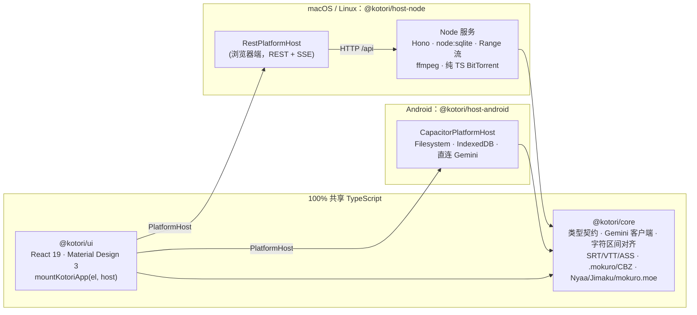

# Kotori（小鳥 / 言採り）

> **Kotori（小鳥 / 言採り · ことり）**：表面是可爱的「小鸟」，拆开则是「**言（こと）+ 採り（とり）**」——**采撷词句之人**。
>
> 面向日语沉浸式学习的极简 AI 陪读与观影工具：看动漫、读漫画时点一下字幕或气泡里的任意字符，**Gemini Flash** 立即给出整句拆解（振假名、意群、📘 课本标准形 vs 🔥 口语演变、词汇、语法），并自动高亮你点击的那一块；同一句换个位置点，高亮 0 延迟切换。

- **三端独立运行**：macOS、Linux（纯 Node.js 解释执行，**零新增编译二进制**）与 Android（Capacitor 独立 APK）。
- **全栈 TypeScript**：一套 UI、一份类型契约（`PlatformHost`），两个宿主实现。
- 产品设计见 [DESIGN.md](./DESIGN.md)，技术架构与模块边界见 [ARCHITECTURE.md](./ARCHITECTURE.md)。

---

## 目录

1. [功能一览](#功能一览)
2. [架构](#架构)
3. [环境要求](#环境要求)
4. [macOS / Linux 快速开始](#macos--linux-快速开始)
5. [开发模式](#开发模式)
6. [Android：构建独立 APK](#android构建独立-apk)
7. [配置 Gemini Flash](#配置-gemini-flash)
8. [配置 Jimaku 字幕下载](#配置-jimaku-字幕下载)
9. [数据目录与命令行参数](#数据目录与命令行参数)
10. [测试与质量门禁](#测试与质量门禁)
11. [常见问题](#常见问题)

---

## 功能一览

| 模块 | 能力 |
| :--- | :--- |
| 🎬 **动漫** | 本地 MP4 / MKV / WebM 播放（HTTP Range 流式传输）；外挂字幕自动匹配（`.ja.ass`、`.srt`、`.vtt` …）；MKV 内嵌文本字幕提取（需系统已安装 `ffmpeg`）；ASS 逐字卡拉 OK 合并为整句；右侧时间轴联动、句级跳转、单句复读 / A-B 循环、多句合并拆解；Jimaku 日语字幕一键自动匹配下载 |
| 📖 **漫画** | `.mokuro` 预识别漫画（气泡精准点读）；`.cbz` / `.zip` / 图片文件夹；RTL 双页跨页、单页、Webtoon 模式；生肉漫画框选气泡 → Gemini VLM 识别并拆解；✨ 整页导读 |
| 🧠 **AI 拆解** | 整句 `<ruby>` 振假名、语义块（📘 textbookForm / 🔥 spokenEvolution）、词汇（原形、读音、词性、JLPT、音调）、语法点、多轮追问（流式输出）；结果按句缓存，再次点击秒开 |
| ⬇️ **下载** | Nyaa RSS 搜索 + **内置纯 TypeScript BitTorrent 引擎**（桌面端，边下边播的顺序优先下载）；Jimaku 字幕；`mokuro.moe` 目录浏览与整卷下载；完成后自动入库 |
| ⚙️ **设置** | Gemini API Key / Vertex AI（ADC、服务账号 JSON、Access Token、Express Key）；Material Design 3 主题（种子色、深浅色）；界面语言 简体中文 / English / 日本語 |

---

## 架构



| 包 | 职责 |
| :--- | :--- |
| [`packages/core`](./packages/core) | 平台无关核心：`src/types.ts` 跨包类型契约（`PlatformHost` 等）；Gemini REST 客户端（AI Studio 与 Vertex AI 双认证，无 SDK）；确定性 `alignSpans` 字符区间对齐与振假名构建；字幕解析与卡拉 OK 合并；`.mokuro` / CBZ / 跨页布局；Nyaa / Jimaku / mokuro.moe / magnet 解析器。不依赖任何 `node:*` 或 DOM 专有 API。 |
| [`packages/ui`](./packages/ui) | 共享前端：React 19 + 自研轻量 M3 组件（CSS 变量 + `material-color-utilities` 生成色板）、zustand 状态、四大页签、`AiBreakdownPanel`；只通过 `useHost()` 访问平台。自带 `MockPlatformHost` 演示数据。 |
| [`packages/host-node`](./packages/host-node) | 桌面宿主：Node 服务端（Hono 路由、`node:sqlite` WAL 数据库、HTTP 206 视频流、`ffmpeg` 字幕提取、纯 TS BitTorrent、下载管理器）+ 浏览器端 `RestPlatformHost`（REST + SSE）。`dist/server.mjs` 为 esbuild 单文件包，最终用户只需 `node`。 |
| [`packages/host-android`](./packages/host-android) | Android 宿主：完全运行在 Capacitor WebView 内的 `CapacitorPlatformHost`（IndexedDB 存储、Filesystem 文件、直连 Gemini / Jimaku / mokuro.moe；种子链接交给外部 BT 应用）。 |

**零原生插件保证**：`pnpm-workspace.yaml` 设置 `onlyBuiltDependencies: []`（pnpm 拒绝执行任何依赖的编译脚本）并屏蔽 `better-sqlite3`、`node-datachannel`、`sharp` 等原生模块；`pnpm check:native` 会扫描 `@kotori/host-node` 与 `@kotori/core` 的运行时依赖树，发现 `.node` / `binding.gyp` / `node-gyp` 即失败。数据库使用 Node 内置的 `node:sqlite`，BitTorrent 由纯 JS 的 `bencode` / `bittorrent-protocol` / `bittorrent-dht` / `ut_metadata` 加自研胶水实现（**不使用 webtorrent**）。

---

## 环境要求

| 用途 | 要求 |
| :--- | :--- |
| 运行桌面版 | **Node.js ≥ 22.13**（内置 `node:sqlite`、`fetch`）。无需 Python / C++ 编译工具链。 |
| 开发 / 构建 | 上述 Node.js + **pnpm 10**（`corepack enable` 后即可使用仓库声明的 `pnpm@10.32.1`） |
| MKV 内嵌字幕（可选） | 系统已安装 `ffmpeg` 与 `ffprobe`（macOS：`brew install ffmpeg`；Debian/Ubuntu：`sudo apt install ffmpeg`）。未安装时该功能自动隐藏。 |
| Android APK | JDK 21、Android SDK（含 Build-Tools 与 Platform），设置 `ANDROID_HOME` / `JAVA_HOME` |
| AI 功能 | Google AI Studio API Key **或** Google Cloud Vertex AI 项目 |

---

## macOS / Linux 快速开始

```bash
git clone <repo-url> kotori && cd kotori
corepack enable            # 启用 pnpm 10
pnpm install               # 不会编译任何原生插件
pnpm build                 # 构建 Web UI（dist/web）+ 服务端单文件包（dist/server.mjs）
node packages/host-node/bin/kotori.mjs
```

启动后服务只监听 `http://127.0.0.1:7865`（本机工具，无鉴权），并自动打开界面：

- 若检测到 Chrome / Chromium / Edge / Brave，会以 `--app=` **独立窗口**打开（使用 `~/.kotori/chrome-profile` 独立配置）；
- 否则调用 `open`（macOS）/ `xdg-open`（Linux）在默认浏览器中打开；
- 加 `--no-open` 则不打开浏览器，手动访问上述地址即可。

也可以用 `pnpm start:node` 代替最后一行。首次使用请到 **⚙️ 设置** 填写 AI 凭据（见[配置 Gemini Flash](#配置-gemini-flash)），再到 **🎬 动漫** / **📖 漫画** 通过路径浏览器导入本地文件夹。

> [!NOTE]
> Node 22 首次加载 `node:sqlite` 会打印 `ExperimentalWarning: SQLite is an experimental feature`；`bin/kotori.mjs` 只过滤这一条警告，其他警告照常输出。

### 视频格式说明

播放使用浏览器原生 `<video>`，不做转码。MP4 / WebM 一般都能播放；MKV 在 Chromium 内核中可播放 **H.264 / VP9 / AV1 + AAC / Opus / Vorbis / FLAC** 组合，HEVC、AC-3 等编码可能无法播放（安装了 `ffprobe` 时导入后会弹出提示）。

---

## 开发模式

### 纯前端演示（无需后端）

```bash
pnpm dev:ui                # http://localhost:5174，使用 MockPlatformHost 内置演示数据
```

演示数据包含 2 部动漫 × 3 集（含 ASS 逐字卡拉 OK）、一卷 10 页 `.mokuro` 漫画、一卷生肉漫画、预置的 AI 拆解结果与模拟下载进度。支持查询参数快速定位，例如 `?tab=manga`、`?explain=食べてんじゃねぇよ！&focus=3`、`?theme=dark`。

### 桌面全栈热重载

开两个终端：

```bash
pnpm dev:node                                  # 终端 1：tsx watch 启动 API 服务（127.0.0.1:7865，--dev 不打开浏览器）
pnpm --filter @kotori/host-node dev:web        # 终端 2：Vite 开发服务器 http://localhost:5173（/api、/media 代理到 7865）
```

在浏览器访问 `http://localhost:5173`，UI 与服务端代码修改都会即时生效。

---

## Android：构建独立 APK

Android 版把同一套 UI 打包进 Capacitor WebView，宿主逻辑全部在 WebView 内运行（无 Node）：

- 元数据存 IndexedDB，导入的漫画 / 字幕 / 下载文件存 App 私有目录（`Directory.Data`）；
- AI 直接从设备请求 Gemini（支持 API Key、Vertex Access Token、服务账号 JSON、Express Key；**不支持 ADC**）；
- 能力差异：无内置 BitTorrent（magnet / `.torrent` 链接交给已安装的外部 BT 应用打开）、无 MKV 内嵌字幕提取、无服务端路径浏览（改用系统文件 / 目录选择器）。

```bash
export ANDROID_HOME="$HOME/Android/Sdk"           # 按实际路径修改
export JAVA_HOME="/path/to/jdk-21"

pnpm install
pnpm --filter @kotori/host-android build:web      # 生成 packages/host-android/www

# 仅首次：生成 Android 原生工程（packages/host-android/android/）
pnpm --filter @kotori/host-android cap:add

# 推荐：安装目录选择器插件（用于“导入文件夹”），装好后重新 sync
pnpm --filter @kotori/host-android add @capawesome/capacitor-file-picker

# 每次 Web 代码变更后：重新构建并同步到原生工程
pnpm --filter @kotori/host-android cap:sync

# 构建 APK
cd packages/host-android/android
./gradlew assembleDebug                           # 产物：app/build/outputs/apk/debug/app-debug.apk
# 发布版：./gradlew assembleRelease（需先在 app/build.gradle 配置签名）
```

其他常用命令：

```bash
pnpm --filter @kotori/host-android cap:open       # 用 Android Studio 打开工程
pnpm --filter @kotori/host-android cap:run        # 构建、同步并安装到已连接的设备 / 模拟器
adb install -r packages/host-android/android/app/build/outputs/apk/debug/app-debug.apk
```

> [!IMPORTANT]
> `@capacitor/filesystem` 8 本身不提供目录选择器，Kotori 通过 `registerPlugin('FilePicker')` 调用 `@capawesome/capacitor-file-picker`（无编译期依赖）。未安装该插件时“选择文件夹”会提示不支持，“选择文件”会退回到 `<input type="file">` 并把文件复制到 App 私有目录。

`capacitor.config.ts` 已开启 `CapacitorHttp`，用于绕过 WebView 中第三方接口（Jimaku、Nyaa、mokuro.moe 目录）的 CORS 限制；Gemini 请求则走 WebView 原生 `fetch`（`CapacitorWebFetch`），以保留流式输出与取消。大文件下载使用 `Filesystem.downloadFile` 直接写盘，漫画归档按条目流式解压，避免整包读入内存。

---

## 配置 Gemini Flash

在 **⚙️ 设置 → AI** 中选择提供商，填写后点击 **测试连接**（发送一个极小的请求并显示延迟）。默认模型：拆解与追问 `gemini-2.5-flash`，漫画视觉识别 `gemini-2.5-flash`，均可修改；温度默认 0.2，可设置 thinking budget（`0` 关闭思考）与请求超时。

### 方式一：Google AI Studio（Gemini API Key）—— 最简单

1. 打开 [Google AI Studio](https://aistudio.google.com/apikey) 创建 API Key；
2. 设置中选择 **Gemini API Key**，粘贴密钥；
3. （可选）自定义 Base URL（代理）与 API 版本（默认 `v1beta`）。

### 方式二：Vertex AI

先在 Google Cloud 项目中启用 **Vertex AI API**。设置中选择 **Vertex AI**，填写 **项目 ID** 与 **区域**（如 `us-central1`，或 `global` 使用 `https://aiplatform.googleapis.com`），再选择一种认证方式：

| 认证方式 | 适用平台 | 用法 |
| :--- | :--- | :--- |
| **ADC（应用默认凭据）** | 仅桌面 | 本机执行 `gcloud auth application-default login`（或设置 `GOOGLE_APPLICATION_CREDENTIALS` 指向服务账号文件）。Kotori 通过 `google-auth-library` 自动获取并刷新令牌。 |
| **服务账号 JSON** | 桌面 / Android | 在 IAM 中为服务账号授予 `Vertex AI User` 角色并创建 JSON 密钥，把**文件全文**粘贴到设置中。令牌交换在 `@kotori/core` 内用 WebCrypto 签名 JWT 完成，自动缓存与提前刷新。 |
| **Access Token** | 桌面 / Android | 粘贴 `gcloud auth print-access-token` 的输出。令牌约 1 小时过期，过期后需重新粘贴（过期时会出现 `ai-auth` 错误）。 |
| **Express API Key** | 桌面 / Android | Vertex AI Express 模式的 API Key，**无需项目 ID**。 |

> [!CAUTION]
> API Key、Access Token、服务账号 JSON 都保存在本机（桌面：`~/.kotori/kotori.sqlite`；Android：App 私有 IndexedDB），不会上传到除 Google 接口外的任何地方；日志输出前会自动脱敏。请勿把数据目录分享给他人。

AI 拆解结果按 `(句子, 目标语言, 模型, 提示词版本)` 缓存，同一句再次点击不再请求网络；可在设置中关闭缓存或一键清空。拆解输出语言（简体中文 / 繁體中文 / English）在设置中选择。

---

## 配置 Jimaku 字幕下载

[Jimaku](https://jimaku.cc) 的 API 需要密钥：

1. 注册并登录 jimaku.cc，在账户页面生成 **API Key**；
2. 填入 **⚙️ 设置 → 动漫 → Jimaku API Key**；
3. 在剧集详情页点击 **自动获取 Jimaku 字幕**：Kotori 按剧名搜索条目，按集数匹配文件（优先 `.ass` > `.srt` > `.vtt`、最新版本），下载后自动挂载为字幕轨；`.zip` 字幕包会自动解压并逐集匹配。也可以在 **⬇️ 下载 → 字幕** 中手动搜索下载。

---

## 数据目录与命令行参数

桌面版默认数据目录为 `~/.kotori/`：

```
~/.kotori/
├── kotori.sqlite          设置、媒体库、阅读/播放进度、AI 缓存、下载任务（WAL 模式）
├── subtitles/             下载 / 提取 / 上传的字幕（按剧集分目录）
├── downloads/             默认下载目录（可在设置中修改）
├── manga/                 解压后的漫画归档、mokuro.moe 下载的整卷
├── torrents/              BitTorrent 断点续传位图（*.bitfield）
├── cache/
└── chrome-profile/        独立窗口模式的浏览器配置
```

```bash
node packages/host-node/bin/kotori.mjs [选项]
```

| 选项 | 默认值 | 说明 |
| :--- | :--- | :--- |
| `--port <n>` | `7865` | 监听端口；被占用时自动尝试后续 10 个端口。也可用环境变量 `KOTORI_PORT`。 |
| `--host <addr>` | `127.0.0.1` | 监听地址（无鉴权，**不建议**改为对外地址）。 |
| `--data-dir <dir>` | `~/.kotori` | 数据目录。也可用环境变量 `KOTORI_DATA_DIR`。 |
| `--web-dir <dir>` | `dist/web` | 自定义静态 UI 目录。 |
| `--no-open` | — | 不自动打开浏览器。 |
| `--dev` | — | 开发模式（不托管静态 UI、不打开浏览器，配合 Vite 使用）。 |

`ffmpeg` 不在 `PATH` 中时，可设置 `KOTORI_FFMPEG_DIR` 指向包含 `ffmpeg` 与 `ffprobe` 的目录。

---

## 测试与质量门禁

```bash
pnpm typecheck         # 全部 4 个包的严格 TypeScript 检查（exactOptionalPropertyTypes、noUncheckedIndexedAccess …）
pnpm test              # Vitest：全部单元 / 集成测试（离线运行）
pnpm build             # 桌面 Web UI + 服务端单文件包 + Android www
pnpm check:native      # 确认运行时依赖树中没有任何原生插件
```

测试覆盖示例：字幕解析与卡拉 OK 合并（含真实 ASS / Shift_JIS 样本）、`alignSpans` 属性测试、`.mokuro` 两种页面根目录约定、`RestPlatformHost` ↔ Hono 全路由覆盖、HTTP 206 / 416 Range、两个 BitTorrent 客户端经回环地址完成种子→下载（含仅 magnet 的 `ut_metadata` 元数据获取）、Android 宿主基于 `fake-indexeddb` 的全方法映射、UI 的点击→字符索引与双向高亮。

单独运行某个包：`pnpm --filter @kotori/host-node test`。

---

## 常见问题

**启动报 `dist/server.mjs missing`？**
先执行 `pnpm build`（或仅构建桌面端：`pnpm --filter @kotori/host-node build`）。

**界面打开后显示 “Kotori server is running” 而不是应用？**
说明 Web UI 尚未构建（`packages/host-node/dist/web` 不存在），执行 `pnpm build` 后重启。

**AI 报 `ai-auth` / `ai-quota` / `ai-timeout`？**
分别表示凭据无效或过期、配额 / 速率受限（HTTP 429）、请求超时（可在设置中调大超时）。在设置页点击“测试连接”可以快速定位。

**MKV 有画面没声音或无法播放？**
多为 AC-3 / DTS 音频或 HEVC 视频，浏览器无法解码；可先用 `ffmpeg -i in.mkv -c:v copy -c:a aac out.mkv` 转换音轨。

**BitTorrent 下载没有速度？**
确认防火墙未拦截出站连接；Kotori 使用 Nyaa 默认 tracker 与 DHT 获取节点，冷门种子可能需要等待。下载完成后默认停止做种，可在设置中开启“完成后继续做种”。

---

## 许可证

MIT
